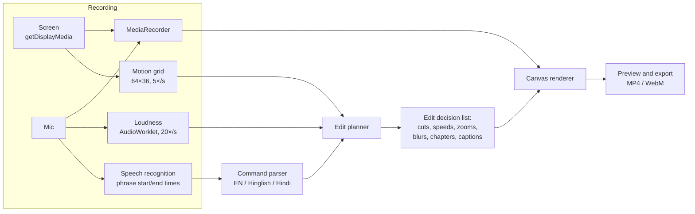

# Retake

**A screen recorder you direct out loud.**

Record your screen and talk as you normally would. Fumble a sentence? Say **"scratch that"** and it's gone. Something too small to read? Say **"zoom here"**. Pasted an API key on screen? Say **"hide that"** and it's blurred from the moment it appeared. Stop recording, and the video is already edited, captioned and split into chapters.

No timeline. No editing session. No upload: everything happens in your browser.

> Built for the WeMakeDevs × Wispr Flow **No Hands** challenge (Builders track).

---

## The problem

Anyone who records screen demos (developers, teachers, founders, support teams) spends longer editing than recording: hunting for the take where they stumbled, cutting dead air while `npm install` runs, zooming in on tiny text, and scrubbing frame by frame to blur a key or an email they showed by accident. Leaked secrets in demo videos are a real security problem.

Existing tools fix this **after** recording: you scrub a timeline, or an AI guesses which take was bad. But at the moment you fumble, you already know. Retake lets you say so.

## What it does

| Say | Retake |
|---|---|
| **"scratch that"** | Cuts the sentence you just fumbled, and what happened on screen while you said it. If you said it mid-sentence, only that breath is cut. |
| **"hide that"** | Finds what just appeared on screen and pixelates it **from the moment it first appeared** (before you noticed) **until it leaves the screen**. |
| **"zoom here"** / **"zoom out"** | Smoothly zooms into the area of the screen that just changed, then eases back out. |
| **"look here"** | Dims the screen and rings what just changed, for three seconds. |
| **"speed this up"** / **"normal speed"** | Fast-forwards the boring part (installs, builds, uploads) at 2×, 4× or 8×, with an on-screen badge. |
| **"chapter: setup"** | Adds a chapter card on screen and a YouTube timestamp. |
| **"title: my project"** | Opens the video with a title card. |
| **"mark that"** | Drops a bookmark. |
| **"big camera"** / **"small camera"** | Grows your camera bubble to fill the frame (intros, outros), then sends it back to its corner. |
| **"hide camera"** / **"show camera"** | Gets your face out of the way when it covers something on screen. |

Hinglish and Hindi work too: *kaat do*, *chhupa do*, *zoom karo*, *tez karo*, *अध्याय: …*.

And without being asked:

- **You, in a bubble.** Your webcam is recorded alongside the screen and shown as a circle or rounded square. Drag it anywhere on the preview, snap it to a corner, or resize it, all after recording, because the camera is kept as its own track. Its ring glows while you speak.
- **Dead air is trimmed**, but only where nothing happens on screen. If you're silent because you're typing, it's kept.
- **Captions** are burned in and exported as `.srt` / `.vtt`, with your directions removed from them.
- **YouTube chapters** are generated, with a warning if they don't meet YouTube's rules.
- **Live slate with your camera:** a 3-2-1 countdown (Retake is already listening, so "big camera" works from the first word), then a slate showing your camera preview, a timer, a mic level, what Retake heard, and each command as it lands. It can float above other windows.
- **Smooth cuts:** every cut is snapped to a silence, crossfaded over a third of a second, and the audio is ramped so there are no clicks.
- **Three versions of every take:** **Final** (what viewers get), **Demo** (your spoken commands stay in, each labelled with what Retake did, and the parts that would be cut play fast under a red overlay, which is ideal for showing Retake off) and **Raw**. Any of them can be exported.
- **Nothing is final:** every direction appears in the Director's notes with a switch to undo it, and a **Raw take** toggle shows the original for comparison.
- **Private:** recording, speech recognition (Chrome's built-in), analysis and rendering all run in the browser. The last take is kept in this browser so a refresh doesn't lose it.

## Try it

- **Sample take, no recording needed:** open the app and tap **Try the sample take** (or go to `/?sample`, or `/?sample&demo` to open it in the Demo version). It's a 72-second recording of a developer building a weather app, complete with dead air, a 20-second `npm install`, a pasted API key, a fumbled sentence and a tiny chart, and narration that directs Retake to fix all of it. Retake turns it into a 38-second video.
- **Your own take:** **Record a take** in Chrome or Edge on a computer, pick a window or tab, and talk.

## How it works



**Three signals, recorded side by side:**

1. **What you said, and when.** Live speech recognition gives phrases with approximate start and end times.
2. **How loud you were.** An AudioWorklet measures mic loudness 20 times a second. Cut boundaries are snapped to real silences, so cuts never clip a word, and dead air is found here. The silence threshold adapts to your room's noise.
3. **Where the screen changed.** Five times a second, the screen is shrunk to a 64×36 grayscale grid and compared with the previous frame. It is read from the video track's frames, so it keeps working while Retake's tab is in the background.

**The planner** (`src/plan.js`) combines them:

- **"scratch that"** cuts from the start of the fumbled sentence, snapped to the silence before it, to the end of the command.
- **"hide that"** looks back for the most recent burst of screen change. It ignores tiny changes such as a moving mouse or a blinking caret, takes the main region the burst touched, and starts the blur at the moment that region began changing. The blur ends when most of that region changes again (a tab switch, a scroll).
- **"zoom here"** aims at the busiest region of the last few seconds, weighted towards the most recent, and ranked by area so a blinking caret never wins.
- **Dead air** is shortened only when the mic is quiet *and* the screen is static.

The result is a list of segments (with speed), zooms, blurs, spotlights, chapters and captions, plus exact source↔output time mapping.

The plan is rebuilt from scratch whenever you flip a switch or change a setting, so editing is non-destructive. **The renderer** (`src/render.js`) draws each output frame from the plan: the virtual camera with eased zoom, pixelation, spotlight, cards, badge and captions. The preview and the export share it, so what you see is what you get. Export records the canvas in real time with the original audio, pausing the recorder while the video seeks across a cut so no frozen frames get in.

**Type:** Fredoka and Nunito, rounded and calm, in both the app and the video overlays.

**No dependencies.** No frameworks, no build step, no npm packages. The app is plain ES modules; the tests use Node's built-in runner.

## Tests

```bash
npm test
```

21 tests on the command parser, motion analysis and planner, including:

- every direction in English, Hinglish and Devanagari Hindi;
- ordinary narration ("this hides the sidebar", "the cut off date") is not mistaken for a direction;
- "scratch that" cuts the fumbled sentence, or only the fumbled breath when said mid-sentence;
- "hide that" ignores the mouse and the caret, starts the blur when the secret appeared, and ends it when the secret leaves the screen;
- dead air is trimmed but silent typing is kept;
- zoom aims at the right region, eases, and stays inside the frame;
- switching a direction off restores the footage;
- source↔output time mapping round-trips exactly; SRT and YouTube chapter output;
- camera directions build a timeline with smooth transitions, and are ignored inside ordinary sentences ("we bought a big camera");
- the Demo version keeps commands audible, plays would-be cuts fast, and still reports the final cut's numbers.

The full app was also driven end to end in headless Chromium: the sample take, every effect rendered, undo, Raw/Retake comparison, a complete real-time export (checked with ffprobe), and a real recording using simulated screen, microphone and camera devices.

## Run locally

Node 18 or newer, nothing to install:

```bash
npm run dev     # http://localhost:5173
```

Screen recording needs `localhost` or HTTPS.

## Deploy (free)

**Vercel:** import the GitHub repo. No build settings, no environment variables.
**GitHub Pages:** Settings → Pages → deploy from the `main` branch root.

## Browser support

| | Chrome / Edge (desktop) | Firefox | Safari | Phones |
|---|---|---|---|---|
| Try the sample, edit, export | ✓ | ✓ | ✓ (WebM/MP4 depending on version) | ✓ |
| Record | ✓ | ✓ | ✓ | – (browsers can't capture the screen) |
| Voice directions | ✓ | – | partial | – |
| Floating slate | ✓ (116+) | – | – | – |

## Project layout

```
index.html, styles.css    the app
src/commands.js           the director's vocabulary and parser
src/motion.js             screen-change grid, "where did it change", "what appeared", "when did it leave"
src/plan.js               edit planner, time mapping, SRT/VTT, YouTube chapters
src/render.js             frame renderer: camera, blur, spotlight, cards, captions
src/player.js             preview playback, video and sample sources, export
src/recorder.js           screen + mic + camera capture, speech timing, loudness, motion, filmstrip
src/sample.js             the procedural sample take and its narration
src/store.js              keeps the last take in this browser
src/app.js                screens and wiring
tests/plan.test.js        tests
```

## Limits

- Phrase timing comes from browser speech recognition, which is approximate; cuts are snapped to silences to compensate. Chrome's recognition needs an internet connection.
- "hide that" protects the region that changed. If a secret scrolls or moves, it hides it until it leaves that spot. Check the preview before publishing.
- Export runs in real time, and the tab must stay open.

## How Wispr Flow was used

Retake is a product about not typing, so I built it the same way. Wispr Flow was my keyboard for everything that wasn't a shortcut:

- **Directing the coding agent.** I spoke every round of feedback, bug report and feature request to my AI coding agent through Flow ("the blur stays on after I switch tabs; it should end when the secret leaves the screen", "add my camera in a corner, and let me say 'big camera' for the intro"). Talking through a bug the way I'd explain it to a colleague was faster than typing it, and more precise.
- **Testing by talking.** Retake's directions are spoken, so every test take was me narrating a demo out loud and checking what Retake did with it.
- **Writing.** I dictated the edits to this README, the narration for the demo video and the submission text, and cleaned them up by voice.

Wispr usage card (Insights): _[attach screenshot]_ · Words dictated during the challenge: _[from the card]_


## License

MIT
